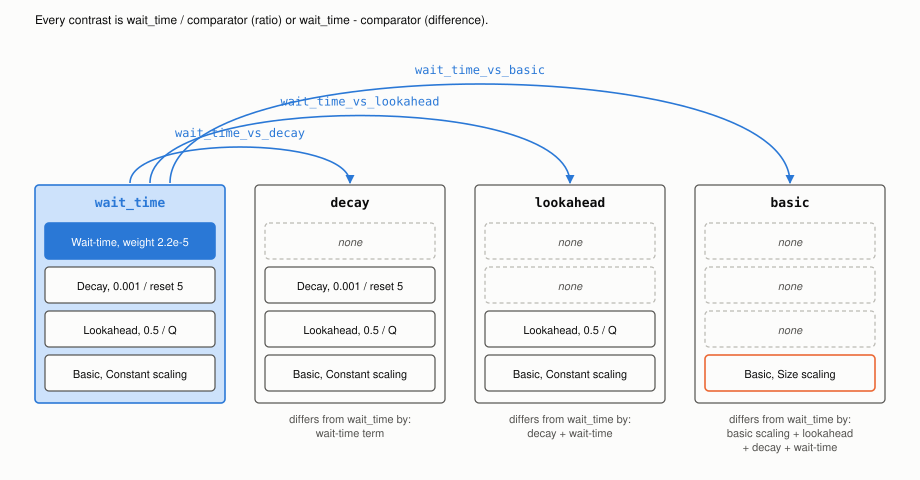
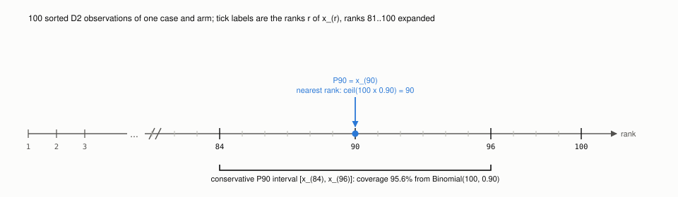
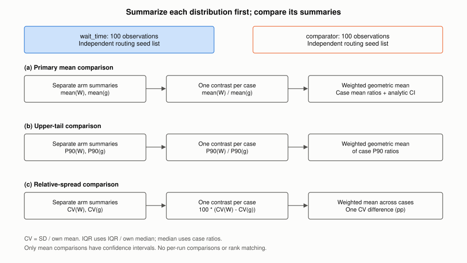
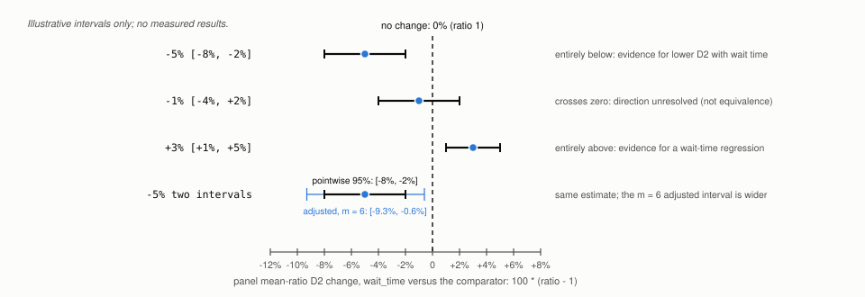
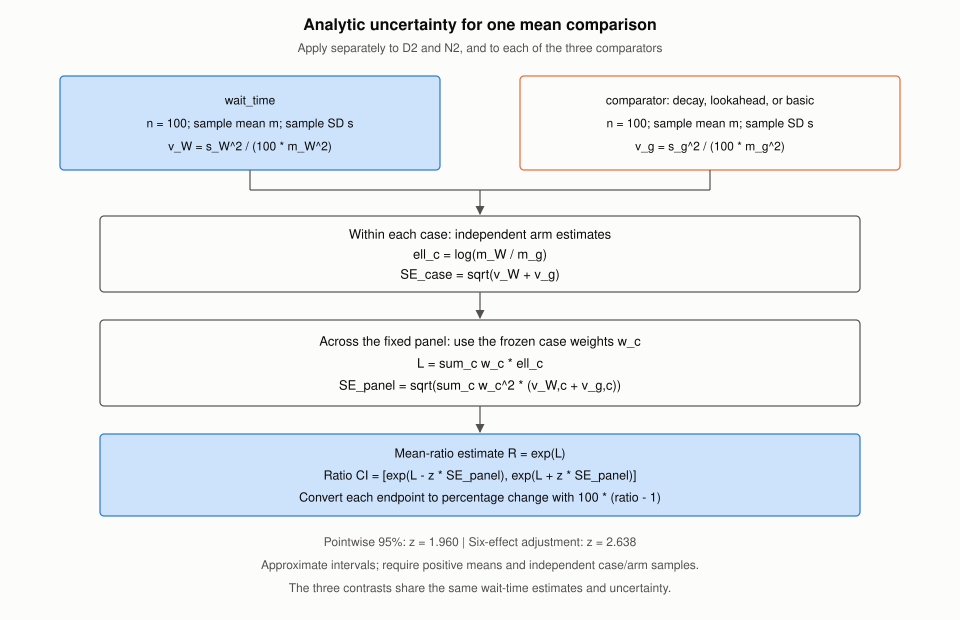

# Benchmark design: wait_time versus decay, lookahead, and basic

Status: implemented as `compare_distributions`. The end-to-end amendment below is
the current default collection protocol. The archived design following it describes
the earlier fixed-layout experiment; its requirements to freeze layouts and sample
routing alone apply only to `--mode fixed_layout`.

## Current protocol amendment: end-to-end layout and routing

Updated on 2026-11-03. New `--mode end_to_end` sessions retain the same 61 scored
cases, frozen weights, four arms, 100 independently sampled outer seeds per
case/arm, three wait-time-first comparisons, descriptive statistics, and
confidence-interval calculations. They change the experimental pipeline:

1. Freeze original logical circuits, targets, optimization settings, native metric
   definitions, seed lists, and 20 layout/20 swap trial budgets before collection.
2. For every case, arm, and seed, run the full preset pipeline from the original
   logical circuit. Each arm's complete heuristic is passed explicitly to
   `SabreLayout`, including its integrated routing, and to any fallback `SabreSwap`.
   Keep the preset's routing conditions and downstream translation/optimization.
3. Allow layouts to differ between arms and seeds. A layout is an output of the
   experiment, not a shared decay-selected input. There is no shared preparation
   seed. The outer seed controls transpilation, including SABRE layout and routing.
4. Record per-run initialization and layout hashes, final native D2/N2, structural
   legality, and replay evidence from initialization through routing. Keep the
   existing handling of failures and missing observations.
5. Record `execution_mode=end_to_end` in the frozen manifest and all report
   metadata. Collect all 24,400 observations in a new output directory; observations
   from the earlier fixed-layout study are not eligible for reuse.

The pinned candidate must expose `SabreLayout(heuristic=...)` as well as the
existing native wait-time component. Its default remains unchanged: wait-time
scoring is enabled only by the benchmark's explicit arm configuration. All four
arms use their own matching components throughout layout and routing.

Only wait time versus decay isolates the added wait-time term. In this mode it
measures that term's effect across the layout-and-routing pipeline. Uncertainty
is conditional on the fixed circuit panel and settings while including variability
in layout selection and routing. It does not condition on a single chosen layout.
This is a different estimand from the archived routing-only experiment; results
must carry the execution mode and must not be pooled across modes.

The existing seed-bootstrap calculation is retained as exploratory sensitivity
analysis. It was introduced after inspecting the original fixed-layout outcomes;
it does not replace the frozen analytic diagnostic statuses in either mode.

See [README.md](README.md) for current commands. The examples and figures below
remain the original fixed-layout design and are not new measurements.

## Archived fixed-layout design

Updated on 2026-11-03. The report evaluates exactly these three ordered comparisons:

```text
wait_time vs decay
wait_time vs lookahead
wait_time vs basic
```

This study uses only scored Qiskit benchmark cases. All measurements use the same frozen cases and exactly 100 independently sampled outer seeds per case and configuration. Compare distribution summaries, without matching runs by seed, sample index, or rank. Comparisons among `decay`, `lookahead`, and `basic` are outside this report.

Figures referenced below live in [figures/](figures/) and are regenerated by `python3 compare_distributions/figures/make_figures.py`. Every number inside a worked example is illustrative; this document reports no measurements.

## TL;DR

- **Run four configurations, report three comparisons.** Collect `wait_time`, `decay`, `lookahead`, and `basic` for 100 runs per case and arm. Reuse the same wait-time observations in all three comparisons; do not run it three times or pick different samples for different comparators.
- **Keep wait time first.** Every effect is `wait_time / comparator` or `wait_time - comparator`. Ratios below one and signed changes below zero favor wait time for the reported lower-is-better statistic.
- **Use only scored 100-seed cases.** Select eligibility from the frozen manifest before examining results. The inspected confirm profile has 61 eligible scored cases, which form the complete study panel.
- **Compare summaries, not individual runs.** Within each case, compare arithmetic means, medians, SDs, IQRs, and P90s calculated separately for each arm. The primary effect is the ratio of arithmetic means; the overall score aggregates these case ratios with frozen weights.
- **Give one aggregate per statistic and comparison.** Across all scored cases, report mean, median, SD, IQR, and P90 comparison estimates, separately for D2 and N2. Add pointwise 95% CIs only to the mean comparisons. Mean/median/P90 use weighted geometric means of case ratios; SD is divided by that arm's own mean and IQR by its own median; the report averages the differences between those normalized spreads with frozen case weights. Section 5.6 defines the complete output.
- **Keep raw distributions.** Report mean, SD, median, IQR, and P90 for each configuration within each case. There is no mandatory division of these statistics by an average across the four heuristics.
- **Normalize P90 directly against the comparator.** Normalized P90 is `P90(wait_time) / P90(comparator)`. This compares the two distributions' 90th percentiles.
- **Separate effect uncertainty from seed variability.** Show analytic confidence intervals for mean comparisons. Retain median, SD, IQR, and P90 as descriptive estimates, with per-case results as supporting evidence. Section 6 explains their interpretation and computation.
- **Use six primary endpoints.** Three comparisons times D2/N2 gives six panel-level mean-ratio effects. Report ordinary pointwise 95% intervals and adjusted intervals for approximately 95% simultaneous coverage of those six effects.
- **Keep the report short and self-contained.** Use a three-row comparison table, effect/tail plots, and concise spread findings. Put complete per-case distributions and diagnostic plots in supporting artifacts.

## 1. Questions and scope

For each comparator, answer:

1. Does wait time change average or typical native two-qubit depth (`D2`) and count (`N2`)?
2. Does it change variability across seeds, measured by SD and IQR?
3. What happens to P90?
4. How precisely are mean comparisons estimated, and which cases regress?

The comparison population is the frozen benchmark panel with the selected targets, layouts, optimization levels, trial budgets, and the declared random-seed sampling protocol. The conclusions concern that panel and configuration, not every possible circuit or target.

| Quantity | What it describes |
| --- | --- |
| Mean and median | Average and typical outcomes across seeds |
| SD and IQR | Variability of individual seed outcomes |
| P90 | The 90th percentile of the output distribution; lower is better for D2/N2 |
| Mean performance ratio | Ratio of arithmetic means within a case; weighted geometric aggregation of those ratios across cases |
| Normalized P90 | Wait-time percentile divided by the matching comparator percentile |
| Confidence interval | Uncertainty in an estimated statistic or comparison |

The parent-versus-candidate default-pipeline check may remain a separate software compatibility check. It does not add a fourth statistical comparison to this report. Additional component ablations or comparisons among the other presets require a separate study.

## 2. Current implementation and provenance

The benchmark repository is `../../qiskit-transpile-bench/`; the candidate implementation is `../../qiskit-evolved/`, relative to this document.

The inspected candidate is `319fa5fa703bc924008db812f5ddfec6b56c38f7`, based on `1298f960b7e814cfcb6aa9338b548ec5c6d2b355`. Wait-time scoring is opt-in. Default presets and `SabreLayout` do not automatically enable it.

| Area | Current behavior | Change needed |
| --- | --- | --- |
| Quality panel | Confirm v14 has 61 scored cases, all declaring 100 seeds | Retain only scored 100-seed cases and their frozen weights |
| Reporting | Main per-case table reports arithmetic means | Add raw distribution summaries, direct contrasts, and uncertainty |
| Evaluator | Supports paired weighted log effects and an SE | Replace that estimator in this report with arithmetic-mean ratios and analytic mean-ratio intervals |
| Raw data | Per-seed Qiskit benchmark quality measurements are retained | Reuse only records with compatible revision, configuration, and seed provenance |

The supplied Qiskit benchmark extract does not identify its revisions and includes L0/L1. Its 21.80% reduction cannot be carried forward as the result of the current L2/L3, opt-in experiment. See the [existing evidence summary](../files_to_upload_to_the_PR/sabre_wait_time_benchmark_summary.md).

Relevant files:

- [Quality adapter](../../qiskit-transpile-bench/worker/qtb_worker/adapter.py).
- [Statistical evaluator](../../qiskit-transpile-bench/src/qtb/evaluator/statistics.py) and [report summaries](../../qiskit-transpile-bench/src/qtb/reporter/__init__.py).
- [Candidate preset definitions](../../qiskit-evolved/qiskit/transpiler/passes/routing/sabre_swap.py), [heuristic components](../../qiskit-evolved/crates/transpiler/src/passes/sabre/heuristic.rs), and [release note](../../qiskit-evolved/releasenotes/notes/sabre-wait-time-scoring-5be6328a79d04f10.yaml).

## 3. Configurations and experiment execution

### 3.1 Four presets and three contrasts

The Rust fields describe optional components of a complete heuristic:

```rust
pub basic: Option<BasicHeuristic>,
pub lookahead: Option<LookaheadHeuristic>,
pub decay: Option<DecayHeuristic>,
pub wait_time: Option<WaitTimeHeuristic>,
```

The four named presets in the inspected candidate resolve as follows:

| Arm ID / preset | Basic component | Lookahead component | Decay component | Wait-time component |
| --- | --- | --- | --- | --- |
| `preset_basic` / `basic` | Weight 1, `SetScaling.Size` | `None` | `None` | `None` |
| `preset_lookahead` / `lookahead` | Weight 1, `SetScaling.Constant` | Weights `[0.5 / Q]`, `SetScaling.Constant` | `None` | `None` |
| `preset_decay` / `decay` | Same as lookahead | Same as lookahead | Increment `0.001`, reset `5` | `None` |
| `preset_wait_time` / `wait_time` | Same as lookahead | Same as lookahead | Same as decay | Weight `2.2e-5` |

`Q` is `num_coupling_qubits` in the preset constructor. Record the actual coupling and DAG widths.

Use this fixed comparison order throughout the data, tables, and figures:

| Contrast ID | Numerator / first arm | Denominator / comparator |
| --- | --- | --- |
| `wait_time_vs_decay` | wait_time | decay |
| `wait_time_vs_lookahead` | wait_time | lookahead |
| `wait_time_vs_basic` | wait_time | basic |

For ratios use `wait_time / comparator`; for differences use `wait_time - comparator`. A negative signed change favors wait time for the reported lower-is-better statistic. Do not reverse directions between figures. A smaller SD describes narrower outcomes, but is not by itself a better circuit-quality result if the center worsens.

The comparisons have different attribution:

- `wait_time` versus `decay` isolates adding the wait-time term at the inspected preset settings.
- `wait_time` versus `lookahead` also includes the decay component.
- `wait_time` versus `basic` also changes lookahead, decay, and basic scaling.

All three are valid preset comparisons, but only the first isolates the wait-time component. Do not attribute every difference in the other two solely to wire availability. Additional Boolean-component ablations are outside this report.



*Figure 1. The four presets as stacked components. Every contrast starts from `wait_time`; only `wait_time_vs_decay` differs by a single component. The `basic` preset also changes the basic-term scaling from `Constant` to `Size`.*

**Worked example: what each contrast can claim (illustrative numbers).** Suppose the panel D2 effects come out as:

| Contrast | Mean-ratio D2 change | What the number measures |
| --- | ---: | --- |
| `wait_time_vs_decay` | -3% | Adding the wait-time term to the decay preset |
| `wait_time_vs_lookahead` | -8% | Adding decay and the wait-time term to the lookahead preset |
| `wait_time_vs_basic` | -12% | Changing basic scaling and adding lookahead, decay, and the wait-time term |

Only the first row is evidence about wire availability. Differences between these percentage changes cannot be read as additive component contributions. Writing "wait time reduces D2 by 12%" would attribute three other changes to it. Each row answers its own question and none is derived from another.

### 3.2 Independent samples

Use one pinned candidate build for all four efficacy arms. Freeze each case's input circuit, target, preparation pipeline, initial layout, and downstream processing before collecting observations. Record a separate fixed seed for any stochastic preparation.

Each preset has its own independently generated list of 100 routing seeds. Seed IDs are provenance, not matching keys for analysis. Measure final native D2/N2 and preserve the existing legality and routing-replay checks.

For a broader layout claim, declare multiple initial layouts independently of the outcomes. Make the layout identity part of each fixed case and freeze the corresponding case weights. Do not pick a favorable layout for one arm after seeing results.

### 3.3 Identity, caching, and shared observations

Separate `arm_id`, `build_id`, `configuration_digest`, and `contrast_id`. The existing `revision` field distinguishes baseline/evolved builds; do not insert heuristic names into it without a schema change.

Job, observation, checkpoint, cache, and report identities must include resolved heuristic components, preparation/layout identity, and trial budgets. Preserve disabled `None` versus enabled zero-weight components in provenance.

Store each wait-time sample once and reuse it for all three contrasts. Store each comparator sample once. A selected pair's primary effects depend only on its two arms; all three contrasts reuse the same wait-time distribution summaries and mean-variance estimates. The arms are sampled independently, but contrasts sharing wait time are statistically dependent. Never average all four means to define a denominator for this report.

Do not reuse observations from incompatible pipeline configurations. Start a new session after changing the profile or harness, following the existing session-freezing rules.

## 4. Scored 100-seed panel and provenance

Apply eligibility before examining outcomes:

1. Include only cases declared as scored in the frozen manifest with `seeds_per_block == 100`, and freeze a list of 100 unique routing seeds for each case and arm. Generate lists using independently initialized random streams from a recorded master seed and stable case/arm identities. Do not deliberately share a seed schedule across arms or cases; an accidental integer overlap does not create a matched observation.
2. Do not enlarge short runs, truncate larger runs, substitute successful seeds, or select cases by whether they happened to finish.
3. Require all expected observations. A missing/failed sample leaves affected comparisons incomplete; it does not justify dropping the case or changing weights after seeing results.
4. Preserve the frozen weights. The inspected confirm v14 filter retains **61 scored cases**. Their weights sum to one, with each family retaining one eighth.
5. If a different frozen profile requires renormalizing eligible scored weights, do it before execution and record the result. Subpanel weights are the frozen weights renormalized within that declared subpanel.

Four arms require 6,100 quality compilations each, **24,400 total**, before separate compatibility checks. The three comparisons share these observations.

**Worked example: eligibility and weights, read from the manifest before any result.**

| Step | Cases | Note |
| --- | ---: | --- |
| Scored cases in the Confirm v14 manifest | 61 | All declare 100 seeds |
| Scored and `seeds_per_block == 100` | 61 | Complete eligible study panel |
| Expected observations | 24,400 | 61 cases x 100 seeds x 4 arms, each carrying D2 and N2 |

Example weights from the manifest: `confirm/qft_n100/heavy_hex_d9_cz/L2` (family G1) carries `1/48 = 0.020833` and `confirm/qft_cp_n14/melbourne_14_u/L2` (also G1) carries `1/96 = 0.010417`; the ten G1 cases sum to `1/8`. In a G1-only subpanel the first case's renormalized weight is `0.020833 / 0.125 = 0.1667`.

If `confirm/qft_n100/heavy_hex_d9_cz/L2` fails on seed 57 in the `lookahead` arm only, then `wait_time_vs_lookahead` is incomplete for that case and for every aggregate containing it (panel, G1, L2), while `wait_time_vs_decay` and `wait_time_vs_basic` for that case stay complete. The remedy is to rerun seed 57 under the identical configuration, not to drop the seed, drop the case, or reweight.

Record full source and harness revisions, source modifications, build settings, input/target hashes, native gate definitions, optimization level, layouts, resolved heuristic parameters, outer seed IDs, internal trial budgets, host/thread settings, case weights, and analysis settings.

Keep outer seeds and internal trials distinct. Repeating a deterministic seed adds no new independent quality-seed observation. The inference protocol requires independent sampling between case/arm lists. Historical runs with deliberately shared seeds or seed-dependent layouts are not automatically eligible for the independent-arm mean-interval formulas: retain them as descriptive evidence or collect a new compatible session. Removing seed labels does not remove dependence.

Freeze parameters before confirmation. If the confirmation panel influenced tuning, disclose that. Do not increase seed counts until a result becomes significant; this report remains a 100-seed design and must state unresolved precision or tail behavior.

## 5. Statistics for the three comparisons

### 5.1 Raw distributions and quantile convention

For case `c`, arm `h`, and arm-local observation index `i`, let `X[c,h,i]` be D2 or N2. Each index identifies a run from that arm's own seed list; equal indices across arms do not form a pair. Calculate each metric separately. Denote wait time by `W` and the comparator by `g`, where `g` is decay, lookahead, or basic.

For each case and arm retain all 100 observations and report:

```text
n = 100
mean, sample_sd (ddof=1), median, q25, q75, iqr, p90, min, max
```

Use empirical nearest-rank quantiles: sort the `n` observations and take the value at one-based rank `ceil(n*p)`. With 100 observations:

```text
Q25 = x_(25), median = x_(50), Q75 = x_(75), P90 = x_(90)
IQR = x_(75) - x_(25)
```

Here median means the empirical 50th percentile, using the lower middle observation for an even sample size. Record the actual largest observations in tail diagnostics.



*Figure 2. Ranks 81 to 100 of one case and arm. P90 is the 90th sorted observation and is reported as a descriptive point estimate.*

**Worked example (illustrative values).** For one case and arm, suppose the 90th sorted D2 value is `x_(90) = 1310`:

```text
P90 = x_(90) = 1310
```

Keep ties as observed; repeated depth counts retain their positions in the sorted sample.

Raw per-case distributions remain the foundation. For spread comparisons only, divide SD by each arm's own arithmetic mean and IQR by its own median as defined in section 5.4. Mean, median, and P90 comparisons retain their direct case-ratio definitions; do not normalize the raw outcomes or use a four-arm average denominator.

### 5.2 Primary performance comparison

First calculate each arm's **arithmetic mean across its own 100 observations**. Then compare those two means for each `W` versus `g` contrast:

```text
mean[c,h] = sum_i X[c,h,i] / 100
mean_difference[c,g] = mean[c,W] - mean[c,g]
mean_ratio[c,g] = mean[c,W] / mean[c,g]
mean_percentage_change[c,g] = 100 * (mean_ratio[c,g] - 1)

L[g] = sum_c w[c] * log(mean_ratio[c,g])
R[g] = exp(L[g])
panel_percentage_change[g] = 100 * (R[g] - 1)
```

There are no run-by-run differences or ratios, and no logarithms of individual observations. Independently permuting either arm's sample order leaves every statistic unchanged. For medians, retain the raw per-case difference and also calculate `median_ratio[c,g] = Q_0.50(X[c,W,:]) / Q_0.50(X[c,g,:])` using the rank rule in section 5.1. Aggregate positive median ratios with the same frozen-weight geometric rule as the mean ratios, and report the resulting panel median change as a descriptive point estimate. This is a summary of within-case medians, not the median of pooled circuit outcomes.

The scored-case weights sum to one. Label `R` the **weighted geometric mean of per-case arithmetic-mean ratios**. The geometric step is only an aggregation across cases: it gives each case its frozen weight on a relative scale, so circuits with large raw depths or counts do not dominate just because they are large. It is not a ratio of pooled raw means, a geometric mean across runs, or the percentage reduction in the total gate count of the workload.

Within a case, a ratio of `0.95` means the wait-time arithmetic mean is 5% lower. For the panel, `R = 0.95` means a 5% reduction in the weighted mean-ratio score; it does not mean every case improves by 5%. Always show the per-case effects and spread findings alongside the headline.

Compute the same aggregate within each declared family/level subpanel using renormalized frozen weights. No four-arm normalization denominator is used.

**Worked example (illustrative distribution summaries; each actual mean uses 100 observations).**

| Case | Weight | Wait-time mean | Comparator mean | Ratio of means | Mean change |
| --- | ---: | ---: | ---: | ---: | ---: |
| A | 0.75 | 900 | 1,000 | 0.90 | -10% |
| B | 0.25 | 420 | 400 | 1.05 | +5% |

```text
R = exp(0.75 * log(0.90) + 0.25 * log(1.05)) = 0.93536
panel_percentage_change = -6.46%
```

Case B's higher mean remains visible as a regression. SD, IQR, median, and P90 are calculated separately from the same two distributions; a lower mean does not establish narrower spread or a better upper tail.

### 5.3 Normalized P90

Here normalization means a direct ratio to the **same percentile of the named comparator**:

```text
normalized_p90[c,g] = Q_0.90(X[c,W,:]) / Q_0.90(X[c,g,:])
tail_percentage_change[c,g] = 100 * (normalized_p90[c,g] - 1)
```

For example, if wait-time P90 is 900 and decay P90 is 1,000, normalized P90 for `wait_time_vs_decay` is `0.90`, a 10% reduction in that case's empirical P90. Comparing against basic uses basic's P90 instead. The mean of any configuration is not the denominator for these tail statistics.

Across scored cases, aggregate positive percentile ratios using the frozen weights:

```text
R_p[g] = exp(sum_c w[c] * log(Q_p(X[c,W,:]) / Q_p(X[c,g,:])))
percentage_change_p[g] = 100 * (R_p[g] - 1)
p = 0.90
```

Label this the **weighted geometric mean of within-case P90 ratios**. It is neither the percentile of a pooled distribution nor the percentile of seed-by-seed ratios. Report P90 and its comparison effects as descriptive point estimates.



*Figure 3. Every comparison summarizes each arm independently first. The mean ratio, normalized percentile, and normalized spread difference compare those summaries, with no links between individual runs.*

**Worked example: comparing two empirical P90s (illustrative, ten observations per arm).**

```text
W (wait_time):  1200 1210 1225 1240 1250 1260 1275 1290 1310 1320
g (comparator): 1330 1250 1360 1240 1400 1300 1230 1420 1350 1290
```

With ten values, the P90 rank is `ceil(10 * 0.90) = 9`. Take the ninth value after sorting each arm:

```text
P90(W) = 1310                                P90(g) = 1400
normalized_p90 = 1310 / 1400 = 0.9357        (-6.4%: the wait-time upper tail is lower)
```

The normalized percentile compares the two arms' upper tails. Sample positions in the two lists have no correspondence. Compute each arm's percentile separately before dividing them.

### 5.4 Spread changes and the required all-case summary

For each fixed case and arm, calculate raw sample SD and IQR from its own 100 observations:

```text
SD[c,h] = sqrt(sum_i (X[c,h,i] - mean[c,h])^2 / 99)
IQR[c,h] = Q_0.75(X[c,h,:]) - Q_0.25(X[c,h,:])
```

Then **normalize each arm independently: SD by its own arithmetic mean, IQR by its own median**:

```text
normalized_SD[c,h] = SD[c,h] / mean[c,h]
normalized_IQR[c,h] = IQR[c,h] / median[c,h]
```

`normalized_SD` is the **coefficient of variation (CV)** and measures SD relative to that arm's average outcome. `normalized_IQR` is the **IQR-to-median ratio** and measures the middle-half spread relative to that arm's typical outcome. It uses the unscaled IQR, without a normal-distribution calibration factor. Retain the raw arm means, medians, SDs, and IQRs and the raw per-case differences as descriptive evidence about absolute variation.

**Provide one normalized SD comparison and one normalized IQR comparison across all scored cases as descriptive point estimates.** Compare the independently normalized values within each case, then average with frozen case weights:

```text
normalized_sd_change[c,g] = 100 * (normalized_SD[c,W] - normalized_SD[c,g])
normalized_iqr_change[c,g] = 100 * (normalized_IQR[c,W] - normalized_IQR[c,g])

panel_sd_change[g] = sum_c w[c] * normalized_sd_change[c,g]
panel_iqr_change[g] = sum_c w[c] * normalized_iqr_change[c,g]
```

Label the SD result **weighted mean CV difference (percentage points)** and the IQR result **weighted mean IQR-to-median difference (percentage points)**. Negative values indicate lower relative spread for wait time. These are differences of ratios, not percentage reductions in raw SD/IQR, and not the SD/IQR of pooled circuit outcomes. Changes in each arm's mean (for SD) or median (for IQR) can change the result even if its raw spread stays constant.

Normalized SD requires a positive mean in each compared arm; normalized IQR requires a positive median in each compared arm. Zero SD or IQR is allowed when its denominator is positive. Calculate each arm's mean, median, and spreads separately before taking the corresponding normalized difference. Each arm supplies its own denominator.

**Worked example (illustrative; two cases stand in for the full scored panel).**

| Case | Weight | Wait-time mean | Wait-time SD | Comparator mean | Comparator SD | Wait-time CV | Comparator CV | CV difference |
| --- | ---: | ---: | ---: | ---: | ---: | ---: | ---: | ---: |
| A | 0.75 | 80 | 9 | 100 | 10 | 11.25% | 10% | +1.25 pp |
| B | 0.25 | 200 | 16 | 200 | 20 | 8% | 10% | -2.00 pp |

```text
panel_sd_change = 0.75 * (+1.25) + 0.25 * (-2.00) = +0.4375 pp
```

A hypothetical report entry `+0.44 pp` describes higher observed relative SD on the weighted panel. Case A shows why the interpretation matters: raw SD falls from 10 to 9, while CV rises because the mean falls from 100 to 80. For IQR, replace SD with IQR and the mean denominator with the arm's own median. For example, IQRs of 18 and 20 with medians of 80 and 100 give `100 * (18/80 - 20/100) = +2.50 pp` for that case.

Supporting counts of cases with lower/equal/higher spread must identify **raw SD/IQR** versus **normalized SD/IQR** explicitly; their directions can differ. They are descriptive counts, not statistically significant wins. Keep per-case findings visible because the aggregate can hide local effects. SD/IQR and their normalized forms describe observed outcome variability. This report attaches confidence intervals only to means and mean comparisons.

### 5.5 Zeros, failures, and ties

- Missing/failed expected observations make the affected result incomplete. Do not silently drop a seed, case, or arm to get a favorable complete-case result.
- The mean ratio requires a positive comparator arithmetic mean; the log-based panel aggregation additionally requires a positive wait-time mean. Individual zero observations are valid when both means remain positive. A zero wait-time mean with a positive comparator mean gives a valid case ratio of zero (-100%), but the declared log-based panel aggregate is unavailable. If the comparator mean is zero, retain the raw mean difference and mark the ratio unavailable. Do not add an epsilon or redefine the panel after observing results.
- Median and percentile ratios require a positive comparator median or percentile, respectively. The same zero and log-aggregation rules apply to the median as to P90. A percentile ratio requires a positive comparator percentile. A zero wait-time percentile with a positive comparator gives an empirical ratio of zero, but its log-based panel aggregate is undefined. Report that distinction explicitly.
- Normalized SD requires positive means in both compared arms; normalized IQR requires positive medians. Zero SD/IQR is allowed when its own denominator is positive. A zero mean makes the affected normalized SD comparison unavailable; a zero median makes the affected normalized IQR comparison unavailable, even if the mean is positive. Mark the corresponding panel aggregate unavailable and keep raw differences visible. Do not add an epsilon or discard undefined cases.
- For a compared distribution summary, `wait_time = 0, comparator = 0` is a tie; `wait_time > 0, comparator = 0` is a regression; and `wait_time = 0, comparator > 0` is an improvement. Raw evidence remains visible even when a ratio is unavailable.
- If a required scored-case statistic is undefined, mark the corresponding aggregate unavailable instead of silently dropping its weight. Other defined metrics/contrasts may still be reported with their completeness status.
- Zero observed spread or a degenerate interval describes the observed sample, not all possible seeds. Do not report seed-level win/tie/loss rates. Counts of cases with lower/equal/higher summary statistics are a different, descriptive quantity.

### 5.6 One result across cases for every reported statistic

For each of `wait_time_vs_decay`, `wait_time_vs_lookahead`, and `wait_time_vs_basic`, report the following five aggregate statistics separately for D2 and N2. Here `W` is wait time, `g` is the comparator, and `T[c,h]` is an arm's statistic within one fixed case:

```text
G_T[g] = exp(sum_c w[c] * log(T[c,W] / T[c,g]))
aggregate_change_T[g] = 100 * (G_T[g] - 1)
T in {arithmetic mean, median, P90}
```

| Statistic | One estimate across scored cases | Display units | Confidence interval |
| --- | --- | --- | --- |
| Mean | `100 * (G_mean - 1)` | % change in weighted case mean ratios | Pointwise 95% and primary-family adjusted CI |
| Median | `100 * (G_median - 1)` | % change in weighted case median ratios | Not calculated; descriptive estimate |
| SD | `sum_c w[c] * 100 * (SD_W[c]/mean_W[c] - SD_g[c]/mean_g[c])` | CV difference, pp | Not calculated; descriptive estimate |
| IQR | `sum_c w[c] * 100 * (IQR_W[c]/median_W[c] - IQR_g[c]/median_g[c])` | IQR-to-median difference, pp | Not calculated; descriptive estimate |
| P90 | `100 * (G_P90 - 1)`; also retain normalized ratio `G_P90` | % change; ratio in data | Not calculated; descriptive estimate |

Thus the fixed-panel report contains **30 quality estimates: 3 comparisons × 2 metrics × 5 statistics**, with confidence intervals only for the **six mean comparisons**. The other 24 estimates are descriptive. These are comparison effects, not a single raw mean/SD/quantile of a pooled distribution. Keep D2 and N2 separate; there is no combined depth-and-count score.

For this profile, “across cases” means all **61 scored cases with their frozen weights summing to one**. Do not replace the weights with equal weights or exclude a case after seeing its outcomes.

The CI for the aggregate mean comparison uses the analytic variance of the weighted log mean ratios (section 6.3). Combine case variances with **squared weights**. Do not average per-case CI endpoints or treat 100 × 61 observations as one homogeneous sample. These intervals describe seed-sampling uncertainty for this fixed panel, not uncertainty about unseen circuits. All reported effects use zero as the no-change line, but SD/IQR panels must label pp separately from percentage changes.

## 6. Confidence intervals for means only

### 6.1 What a confidence interval means here

Each arm produces outcomes over 100 independent seeds. A different seed sample could change the estimated mean and its comparison with another arm. A **confidence interval (CI)** describes this seed-sampling uncertainty. Calculate CIs only for raw arithmetic means and arithmetic-mean ratios. Raw mean differences, medians, SDs, IQRs, and P90s remain descriptive estimates.

A 95% confidence procedure is designed so that, over repeated samples and recalculated intervals, about 95% of the intervals contain the underlying quantity. It is not a 95% probability that a fixed observed interval contains that quantity. The analytic intervals below have approximate coverage for these benchmark outcomes. [NIST interpretation](https://www.itl.nist.gov/div898/handbook/prc/section1/prc14.htm).

A mean CI describes uncertainty in an average. It does not contain 95% of individual routing outcomes and is not the probability that wait time wins on a random seed. These intervals are conditional on the fixed cases, layouts, configurations, and weights.

| Mean comparison and point estimate | Example interval | Interpretation at the reported interval level |
| --- | --- | --- |
| Panel mean-ratio D2 change `-5%` | `[-8%, -2%]` | Evidence supports a lower weighted D2 mean-ratio score with wait time |
| Panel mean-ratio D2 change `-1%` | `[-4%, +2%]` | The direction remains unresolved |
| Panel mean-ratio N2 change `+3%` | `[+1%, +5%]` | Evidence supports a higher weighted N2 mean-ratio score with wait time |



*Figure 4. Read a mean comparison from the whole interval relative to the reference: zero for percentage changes or differences, one for ratios. The examples are illustrative.*

An interval crossing the reference leaves direction unresolved; it does not establish equivalence. Compare configurations using a direct mean-comparison interval, not by inspecting overlap between separate arm intervals. Mean findings do not establish changes in median, variability, or P90.

### 6.2 Interval scope

| Quantity | Per-case output | Panel output |
| --- | --- | --- |
| Raw arithmetic mean | Point estimate and pointwise 95% Student-t CI | Retain per-case values; no pooled raw-scale mean |
| Arithmetic-mean ratio / percentage change | Point estimate and approximate pointwise 95% log delta-method CI | Weighted mean-ratio estimate with pointwise and six-endpoint adjusted CIs |
| Raw arithmetic-mean difference | Descriptive point estimate | No raw-scale aggregate |
| Median, SD, IQR, P90, and their comparisons | Descriptive point estimates | The required descriptive aggregates from section 5.6 |

Only the six panel mean comparisons belong to the simultaneous family. Per-case mean intervals are supporting pointwise intervals. Record `not_requested` for interval fields of descriptive statistics; do not use zero-width intervals for them.

### 6.3 Analytic calculation from sample means and variances

For each case `c` and arm `h`, calculate the arithmetic mean `m[c,h]` and sample variance `s2[c,h]` with `ddof=1` from its `n[c,h] = 100` observations. Calculate D2 and N2 separately.

A raw arm mean has standard error `sqrt(s2/n)` and the pointwise interval:

```text
mean_CI95[c,h] = m[c,h] +/- t_(99, 0.975) * sqrt(s2[c,h] / 100)
t_(99, 0.975) = approximately 1.9842
```

The Student-t interval is exact for independent normal observations and approximate otherwise. [NIST mean confidence limits](https://www.itl.nist.gov/div898/handbook/eda/section3/eda352.htm).

For a mean ratio, apply the delta method to the logarithm of the two arithmetic means. Under independent arm sampling, its estimated variance is the sum of the two means' squared relative standard errors:

```text
a[c,h] = s2[c,h] / (100 * m[c,h]^2)
ell[c,g] = log(m[c,W] / m[c,g])
v[c,g] = a[c,W] + a[c,g]
case_ratio_CI95[c,g] = exp(ell[c,g] +/- 1.959964 * sqrt(v[c,g]))
```

This is the delta method: the variance of `log(m)` is approximately the squared derivative `(1/m)^2` times the variance `s2/n` of `m`, and the two arms' terms add because the arms are sampled independently. The interval uses the standard-normal critical value because the delta method is a large-sample approximation; the raw-mean interval above uses Student-t. It estimates the uncertainty of a ratio of arithmetic means; no logarithms of individual runs enter the calculation. [Delta-method derivation](https://www.stata.com/support/faqs/statistics/delta-method/).

For the fixed panel, retain the original weights and combine independent case variances with their squared weights:

```text
L[g] = sum_c w[c] * ell[c,g]
V[g] = sum_c w[c]^2 * v[c,g]
SE[g] = sqrt(V[g])
R[g] = exp(L[g])
ratio_CI[g] = [exp(L[g] - z*SE[g]), exp(L[g] + z*SE[g])]
change_CI[g] = 100 * (ratio_CI[g] - 1)
```

Use `z = 1.959964` for pointwise 95% intervals and `z = 2.638257` for the six-endpoint adjustment in section 6.4. The interval is symmetric on the log scale, so its ratio and percentage-change limits are not symmetric around the point estimate; report the limits as computed, without re-centering. For a declared subpanel, renormalize its frozen weights first, then use the same formulas. Each comparison reuses the same wait-time mean and variance. The three comparisons are dependent through those shared observations; Bonferroni does not require independence between comparisons.



*Figure 5. Sample means and variances determine the mean-ratio intervals directly. Case variances receive squared weights when forming the panel variance.*

**Reference sketch (illustrative, not harness code).** `X` has shape `(61 cases, 4 arms, 100 observations, 2 metrics)`; wait time is arm 0, followed by decay, lookahead, and basic. `w` contains the 61 frozen weights in the same case order. This sketch covers complete finite data with positive means and nonzero interval standard errors; apply the validity rules below before reporting results.

```python
import numpy as np
from scipy.stats import norm, t

C, H, N, M = X.shape
means = X.mean(axis=2)                     # (cases, arms, metrics)
s2 = X.var(axis=2, ddof=1)
arm_se = np.sqrt(s2 / N)
arm_half_width = t.ppf(0.975, df=N - 1) * arm_se
arm_mean_ci95 = np.stack(
    [means - arm_half_width, means + arm_half_width], axis=-1
)

relative_variance = s2 / (N * means**2)
case_log_ratio = np.log(means[:, 0:1, :] / means[:, 1:, :])
case_log_variance = relative_variance[:, 0:1, :] + relative_variance[:, 1:, :]
L = (w[:, None, None] * case_log_ratio).sum(axis=0)
V = (w[:, None, None]**2 * case_log_variance).sum(axis=0)
panel_ratio = np.exp(L)
panel_mean_change = 100 * (panel_ratio - 1)

def ratio_interval(log_ratio, variance, z):
    half_width = z * np.sqrt(variance)
    return np.exp(np.stack(
        [log_ratio - half_width, log_ratio + half_width], axis=-1
    ))

z95 = norm.ppf(0.975)
z6 = norm.ppf(1 - 0.05 / (2 * 6))
case_ratio_ci95 = ratio_interval(case_log_ratio, case_log_variance, z95)
panel_ratio_ci95 = ratio_interval(L, V, z95)
panel_ratio_ci_adjusted = ratio_interval(L, V, z6)
panel_change_ci95 = 100 * (panel_ratio_ci95 - 1)
panel_change_ci_adjusted = 100 * (panel_ratio_ci_adjusted - 1)
```

**Validity.** The formulas require independent seed samples within and across cases/arms, finite variances, and sufficiently stable sample means. Log-ratio intervals require positive means in both arms. Strong skew, influential observations, or means poorly separated from zero can make the approximation unreliable; 100 seeds alone does not guarantee accuracy. Record relative standard errors `sqrt(s2/n)/m` for every arm mean, declare the diagnostic thresholds (for example, a maximum relative standard error per arm mean) in the frozen analysis settings before examining results, and mark the affected inference `approximation_unresolved` when those diagnostics fail. Retain the point estimates and raw data.

Missing required observations give `incomplete`. A nonpositive mean makes the log-ratio interval unavailable under the zero rules in section 5.5. If an interval's estimated variance is zero, use `degenerate_observed` and leave its bounds unavailable rather than presenting a zero-width interval as certainty. Do not add epsilon or silently drop cases. The existing paired log-effect estimator targets a different statistic and must not supply this report's standard errors.

### 6.4 Multiple comparisons: six primary endpoints

The primary family contains **three comparisons times two metrics = six panel-level mean-ratio effects**. Report pointwise 95% intervals and Bonferroni-adjusted intervals with nominal individual coverage `1 - 0.05/6 = 99.1667%`. For the latter, use the standard-normal critical value `Phi^-1(1 - 0.05/(2*6)) = 2.638257` in section 6.3. When each individual interval attains its nominal level, the six adjusted intervals jointly cover all six effects with probability at least 95%; because each analytic interval is approximate, the simultaneous coverage is approximate too. [Bonferroni coverage principle](https://www.itl.nist.gov/div898/handbook/prc/section4/prc473.htm).

The adjustment widens each log-scale half-width by `2.638257 / 1.959964`, approximately 1.346. It does not change the point estimate. Dependence through the shared wait-time observations or between D2 and N2 does not require additional independence assumptions for this adjustment.

Median, SD, IQR, and P90 are descriptive and do not enter an expanded interval family. Joint claims over additional per-case or subpanel mean-ratio effects require a predeclared family of size `K` and critical value `Phi^-1(1 - 0.05/(2*K))`.

### 6.5 Across-circuit uncertainty is separate

These mean intervals condition on the fixed panel and describe seed-sampling uncertainty. They do not establish uncertainty about unseen circuits. Keep family and leave-one-family-out summaries as sensitivity analyses. Generalizing to a broader workload requires a separately declared sample of circuit instances; related topology, basis, or optimization-level variants do not supply independent circuits.

### 6.6 Interval metadata

Each mean interval records the independent sampling protocol, conditioning set, metric, case/subpanel, estimate, limits, units, method (`student_t_mean` or `log_delta_mean_ratio`), nominal level, pointwise/adjusted status, endpoint family, seed count, sample variance, standard error, critical value, degrees of freedom where applicable, frozen weights, and validity status. An arm-specific interval identifies `arm_id`; a comparison interval identifies `contrast_id`, wait time, and the comparator.

Use statuses such as `reported`, `not_requested`, `degenerate_observed`, `incomplete`, `undefined_ratio`, and `approximation_unresolved`. Preserve all descriptive statistics and their definitions even when no interval is requested or a mean interval is unavailable.

## 7. Heuristic interpretation and development sensitivity

The confirmatory comparison uses the four pinned presets. It does not tune wait time on the confirmation outcomes while leaving the comparators fixed. Keep any development parameter sweep outside this report and freeze the chosen settings beforehand.

The current readiness counter assigns one abstract unit to a routed two-qubit SABRE interaction and three to an inserted SWAP. Contracted interactions may represent several operations, so those units are not CX cost or hardware time. A small additive weight is not a strict tie-break rule at every circuit size.

A separate development study can inspect wait-time weights such as off, one tenth the proposed value, the proposed value, and ten times it. Record the configuration mechanism and regressions. Such a study does not add arms or contrasts to the three-comparison confirmation report.

D2/N2 support structural quality claims. A claim about duration additionally requires scheduled makespan under frozen usable target durations, including one-qubit operations and applicable scheduling constraints. Missing durations must not silently become zero. Label the result a target-model scheduling estimate, not measured hardware execution time. [Target properties](https://quantum.cloud.ibm.com/docs/en/api/qiskit/qiskit.transpiler.Target).

## 8. Visualization recommendations

Use the same three-comparison order everywhere: wait time versus decay, lookahead, then basic. State wait time as numerator/first arm in every caption. Use accessible colors plus marker/line styles. Include metric, units, case count, weights, seed count, and interval type for mean plots; label other statistics as descriptive.

### 8.1 Main and supporting figures

| Figure | Layout | Meaning and interval rules |
| --- | --- | --- |
| Main effect forest | Three comparator rows; D2 and N2 panels | Wait-time arithmetic-mean-ratio percentage change, aggregated across cases with direct CIs; zero line; distinguish pointwise and adjusted intervals |
| Tail-ratio plot | Three comparator rows; P90 panels for each metric | Plot descriptive percentile ratios with a line at one; no confidence intervals |
| All-case effect forests | Three comparator facets per metric, identical case order grouped by family | Expose local gains/regressions hidden by the panel summary; pointwise analytic intervals for case mean ratios |
| Median effect plot | Three comparator rows; D2 and N2 panels | Descriptive weighted case median-ratio percentage changes |
| Aggregate spread plots | Three comparator rows; separate SD/IQR and D2/N2 panels | Descriptive weighted normalized-spread differences; zero line; CV or IQR-to-median difference in pp |
| Supporting spread counts | Counts of observed lower/equal/higher spread, labeling raw versus normalized SD/IQR | Descriptive breadth; retain per-case differences |
| Selected-case distributions | Three two-distribution ECDF or box-and-point panels per chosen case; wait time repeated alongside each comparator | Raw metric values, visible seed spread and tail observations; clearly distinguish spread boxes from uncertainty bars |
| Tail heatmaps | Cases as rows, three comparators as columns, P90 facets for each metric | Ratio or signed tail percentage change; center at one or zero as appropriate |

Use a compact five-statistic plot grid for each metric, with three comparator rows per panel: mean, median, SD, IQR, and P90. Show CI whiskers only for mean comparisons; use point estimates in the other panels. Give SD/IQR separate pp axes and label ratio or percentage-change axes consistently. Include all five aggregate estimates in the concise comparison table. Include complete case forests and spread details in supporting artifacts. Split 61-case figures into family pages rather than shrinking labels. Figure 4 is the model for the interval-reading note required in section 10.

Raw SD/IQR differences can be shown as descriptive points in case-level supporting plots with appropriate per-case/family axes. The required aggregate SD/IQR plots show differences in independently normalized spread: CV difference or IQR-to-median difference, in percentage points. Lower relative spread need not imply lower absolute spread. Do not substitute SD ratios that become undefined on zero-spread cases without documenting them.

Choose representative distribution examples before inspecting results. Add material regressions under a declared selection rule and identify which comparator triggered selection. Keep discrete ECDF steps and actual extreme observations visible; do not use smoothing to imply an unobserved tail.

### 8.2 Optional views and interpretation

A depth-versus-count tradeoff scatter can use one point per case and one facet per comparator. A mean-versus-spread scatter may use the per-case arithmetic-mean change (%) and raw SD difference, with units and circuit-size limitations explicit; use the required normalized-spread difference for a dimensionless cross-case view, labeling its pp units and relative-spread interpretation.

No all-pairs matrix or comparator-versus-comparator forest is needed. A three-column case heatmap is sufficient for the requested contrasts. Four raw ECDF curves may be shown as descriptive context, but must not introduce new inferential comparisons.

A Q25–Q75 box describes seed outcomes; a mean CI whisker describes uncertainty in an estimated mean or mean comparison. Use distinct styles and legends. Do not infer a contrast from overlap of separate arm intervals. All effect directions must agree: below zero change or below ratio one favors wait time.

Export standalone SVG/PDF figures and PNG previews for the issue. Interactive filtering can supplement them but must not be required to understand the evidence.

## 9. Implementation sequence

| Step | Change | Completion evidence |
| --- | --- | --- |
| 1 | Freeze the scored exact-100 panel, four arms, and three contrast IDs | Only wait time versus decay/lookahead/basic on eligible scored cases enters the statistical report |
| 2 | Add arm/build/configuration identities and cache checks | Each raw sample is stored once and reused across relevant contrasts |
| 3 | Generate and freeze independent seed lists | Each case and arm has 100 independently sampled routing seeds |
| 4 | Implement all five fixed-weight aggregate statistics and raw supporting summaries | Mean/median/P90 case-ratio aggregates and independently normalized SD/mean and IQR/median differences are reproducible |
| 5 | Add analytic mean CIs and metadata | Raw means use Student-t intervals; mean ratios use log delta-method intervals with squared case weights |
| 6 | Implement the six-endpoint primary adjustment | Pointwise and adjusted intervals are distinct; no obsolete all-pairs family remains |
| 7 | Build three-row effect/tail figures, case plots, and concise tables | Directions, denominators, uncertainty, and interval limitations are consistent |
| 8 | Freeze a new session and run confirmation | Complete expected 100-seed observations support the exact claims |

Implement this study as a distinct comparison mode or report stage with its own data-completeness checks. It produces a statistical report, not an automatic `PASS` or `NO_IMPROVEMENT` verdict under the legacy baseline/evolved policy. An undefined ratio or degenerate interval is different from missing required observations.

A decision rule for this study would require a separately specified policy.

Inspect retained observations before recompiling. Reuse only exact-100 records from eligible scored cases with compatible revisions, resolved configuration, independent seed sampling, fixed layouts, and provenance, analyzed with their frozen manifests. Missing arms or changed pipelines/budgets need new measurements.

## 10. Reviewer-facing report and output contract

State the three comparison questions, actual preset definitions, exact revisions/configuration, scored 100-seed eligibility, trial budgets, panel weights, and limits of the heuristic timing model directly in the issue.

For each metric (D2, then N2), the main result table has exactly these three rows and five statistic columns. Each statistic cell contains **one aggregate estimate**. Only the mean column includes a pointwise 95% CI, or an explicit validity status when that interval cannot be reported.

| Comparison | Mean change % + CI | Median change % | CV difference pp | IQR-to-median difference pp | P90 change % |
| --- | --- | --- | --- | --- | --- |
| wait_time vs decay | To be measured | To be measured | To be measured | To be measured | To be measured |
| wait_time vs lookahead | To be measured | To be measured | To be measured | To be measured | To be measured |
| wait_time vs basic | To be measured | To be measured | To be measured | To be measured | To be measured |

Mean, median, and tail columns summarize matching-statistic case ratios with frozen-weight geometric aggregation. The SD column reports the weighted mean **CV difference** and the IQR column the weighted mean **IQR-to-median difference**, both in percentage points. Each arm uses its own mean for SD and its own median for IQR. These measure relative variability, not percentage reductions in raw SD/IQR; a lower raw SD can coexist with a higher CV. Also store normalized P90 ratios in the machine-readable results. Raw per-case findings support these aggregate numbers rather than replacing them.

Provide adjusted intervals for the six primary mean D2/N2 effects in an accompanying compact table or plot, clearly distinguished from pointwise intervals. Use the six-endpoint adjustment in section 6.4. Median, SD, IQR, and P90 findings remain descriptive.

Include a short interval-reading note, modeled on figure 4: an interval entirely below zero change or ratio one supports a lower wait-time value at the reported level; an interval entirely above supports a regression; an interval crossing the reference leaves direction unresolved. Different metrics may show a tradeoff. Do not claim all outcomes improve from one aggregate.

Supporting per-case tables retain all four arms' raw mean, SD, median, IQR, P90, and the three direct comparisons. Attach intervals only to raw means and mean-ratio comparisons. No global four-arm normalization table or comparator-versus-comparator inference is required.

Store raw observations, case and panel summaries, eligibility/exclusion reasons, contrast definitions, interval metadata, and plot data in documented JSON/CSV artifacts. Every result identifies its contributing scored cases. Preserve raw data when a ratio or CI is unavailable.

Attach the complete plots/data and a minimal reproduction recipe. Round displayed precision to match uncertainty. This design document contains no new measured results.

## 11. Review and acceptance checklist

- [ ] All observations used in this study come from scored Qiskit benchmark cases.
- [ ] The scope is exactly wait_time versus decay, lookahead, and basic, always with wait time first.
- [ ] Four preset configurations are measured for 100 runs per case and arm; shared wait-time data are reused without duplicate independent-sample claims.
- [ ] The preset/component distinction and attribution limits of each comparison are documented.
- [ ] Only scored cases declaring 100 seeds are used; each case/arm has an independent frozen 100-seed list, while inputs and layouts are fixed.
- [ ] The 61 scored cases retain their completeness checks and frozen weights.
- [ ] Configuration-aware cache provenance is verified.
- [ ] Primary effects compare arithmetic means first, then aggregate case ratios; no run-by-run ratios, differences, or matching enter the analysis.
- [ ] Raw distribution statistics remain available; there is no four-heuristic mean normalization requirement.
- [ ] Normalized P90 means wait-time percentile divided by the comparator's matching percentile.
- [ ] Tail aggregates are labeled geometric means of within-case percentile ratios, not pooled percentiles.
- [ ] Normalized SD/IQR effects describe relative spread; raw spread differences remain supporting evidence, and case counts specify which definition they use.
- [ ] All five aggregate estimates are reported per comparison and metric: mean, median, SD, IQR, and P90.
- [ ] Only arithmetic means and arithmetic-mean ratios have CIs; median, SD, IQR, and P90 remain descriptive.
- [ ] Required SD/IQR aggregates use each arm's own positive mean for SD and own positive median for IQR, label CV/IQR-to-median differences in pp, and retain the underlying arm summaries.
- [ ] Panel mean-ratio intervals use log delta-method variances combined with squared frozen case weights; no case-level interval endpoints are averaged.
- [ ] Analytic mean CIs use independent arm samples, sample variances with `ddof=1`, and the same wait-time mean and variance in all three comparisons.
- [ ] The main simultaneous family contains six endpoints, with the correct 99.1667% individual interval level.
- [ ] The CI explanation distinguishes sampling uncertainty, outcome spread, equivalence, and probability of winning.
- [ ] Zero values, missing observations, and degenerate intervals are reported without epsilon adjustments or silent reweighting.
- [ ] The new statistical report has its own completeness status and does not silently inherit, weaken, or redefine the legacy two-build acceptance policy.
- [ ] Tables, plots, examples, and machine-readable fields use the same three directions and definitions.
- [ ] Existing legality/routing-replay checks remain applicable and pass before efficacy claims.
- [ ] The issue is concise, self-contained, and includes material regressions and limitations.

## References

- [Candidate heuristic components](../../qiskit-evolved/crates/transpiler/src/passes/sabre/heuristic.rs) and [preset construction](../../qiskit-evolved/qiskit/transpiler/passes/routing/sabre_swap.py).
- [NIST confidence-interval interpretation](https://www.itl.nist.gov/div898/handbook/prc/section1/prc14.htm).
- [NIST mean confidence limits](https://www.itl.nist.gov/div898/handbook/eda/section3/eda352.htm).
- [Delta-method derivation](https://www.stata.com/support/faqs/statistics/delta-method/).
- [SciPy quantile documentation](https://docs.scipy.org/doc/scipy/reference/generated/scipy.stats.quantile.html).
- [NIST Bonferroni method](https://www.itl.nist.gov/div898/handbook/prc/section4/prc473.htm).
- [Qiskit Target](https://quantum.cloud.ibm.com/docs/en/api/qiskit/qiskit.transpiler.Target).
- [Harness metrics](../../qiskit-transpile-bench/docs/metrics.md), [confirm profile](../../qiskit-transpile-bench/docs/confirm-profile.md), and [output format](../../qiskit-transpile-bench/docs/output-format.md).
