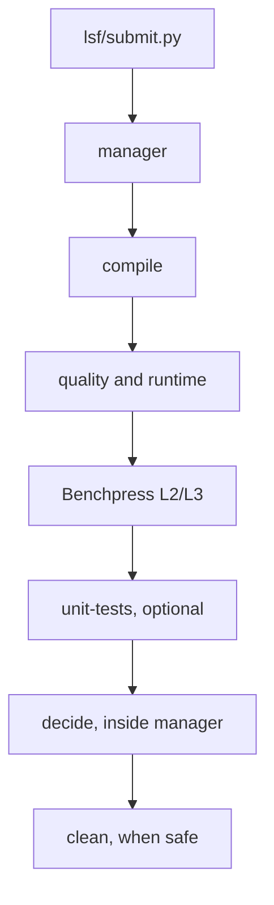

# LSF session guide

[Documentation index](README.md) · [Workflow overview](workflow/README.md) · [Session rules](sessions.md)

One launcher command validates the configuration and submits a manager. The manager
runs each stage as a separate LSF job, records the verdict, then cleans the session
when safe. Quality and Benchpress measure baseline/evolved runtime and run
sequentially. Use an idle machine; no host-load monitoring or timing noise retry is
performed.



Benchpress depends only on successful compilation. The manager runs it even if
quality closes its gate or fails. Optional upstream unit tests require completed
quality and record `skipped` when its gate closes. All jobs request 16 slots on one
host. Serial timing workers keep measurements from competing with other workers
in the same stage.

## Set up and launch

The harness checkout and environment, Qiskit sources, store and sessions must be
visible at identical absolute paths on all nodes. Nodes must have compatible OS,
architecture and Python versions. Build environments also need the Python
interpreter used to create them, often under the shared uv Python directory.

```bash
uv sync --all-extras
command -v bsub bjobs bhist bkill git uv rustup cc c++
mkdir -p /shared/qtb-store /shared/qtb-sessions
uv run python lsf/submit.py \
  --store /shared/qtb-store \
  --results-root /shared/qtb-sessions/idea1 \
  --baseline /shared/qiskit-baseline \
  --evolved /shared/qiskit-evolved \
  --profile confirm-profile \
  --queue normal
```

LSF must support `bjobs -json`. The baseline's Rust toolchain must be available on
compute nodes. Builds and Benchpress preparation fetch pinned dependencies; warm
the caches or provide local source mirrors when compute nodes cannot reach the
network. See [setup and environments](environments.md).

The store and session's parent directory must already exist. Each launch uses a
new session path, which `compile` creates. Source checkouts are snapshotted without
modifying them. `iterations-profile` is the default; use a separate new session
with `confirm-profile` for confirmation. Confirm quality and Benchpress run only
at optimization levels 2 and 3.

Add `--unit-tests` for optional upstream Python/Rust tests. `QTB_STORE` and
`QTB_SESSION` provide path defaults; explicit options win. `--log-level DEBUG` or
`LSF_LOG_LEVEL=DEBUG` enables detailed logging. The launcher prints the manager job
ID, session, log, ledger and report paths. Exit 0 means LSF accepted the manager,
41 an unmet precondition, 40 submission failure and 64 invalid usage.

## Resource settings

| Job | Slots | Memory (GB) | Wall limit |
| --- | ---: | ---: | --- |
| compile | 16 | 64 | 6:00 |
| quality | 16 | 32 | 12:00 |
| benchpress | 16 | 32 | 12:00 |
| unit-tests | 16 | 32 | 10:00 |
| clean | 16 | 4 | 1:00 |
| manager | 16 | 4 | 168:00 |

`--queue` sets a common queue; `--<job>-queue`, `--<job>-mem-gb` and
`--<job>-wall` override a job. Memory uses the site's `LSF_UNIT_FOR_LIMITS=GB`
convention. Wall limits use `[hours:]minutes`. These defaults are starting points;
check your site's queue limits. The manager's wall limit must exceed every stage's.

Pending time counts toward the manager's internal deadline. It reserves time to
cancel owned jobs before the wall limit and refuses to submit a stage that cannot
fit. Each build shares the compile job's slots. The quality timing pass and
Benchpress run serial baseline/evolved measurements without load checks.

## Watch and read results

```bash
uv run python -m lsf.control status --results-root /shared/qtb-sessions/idea1
bjobs -a -J 'qtb-<run-id>-*'
```

The session's `report.md`, `report.json` and `decision.json` contain the benchmark
verdict. Stage reports under `stages/quality/` and `stages/benchpress/` contain the
runtime and circuit-quality comparisons. The sibling `<session>.lsf/report.md`
and `report.json` show every submitted job, outcome, host, logs, resume and cleanup
result. `launch.json` stores the configuration and `ledger.json` the durable job
history. Orchestration records survive session cleanup.

Under `<session>.lsf/logs/<run-id>/`, each launcher, manager invocation and stage
job has separate `.log` and `.events.jsonl` files. LSF output appears in `.out`
files and large scheduler responses in `diagnostics/`. INFO records decisions and
transitions; DEBUG includes unchanged polls and scheduler command responses.

A completed scheduler job is trusted only when its outcome record and stage state
agree on the invocation. A missing `bjobs` entry is checked against `bhist`; an
outcome file alone does not prove the process ended. If termination cannot be
confirmed, the manager leaves the session intact for recovery.

The manager's exit code is the verdict: 0 `PASS`, 10 `NO_IMPROVEMENT`,
20 `CONSTRAINT_VIOLATION`, 30 `INCONCLUSIVE` or 40 `ERROR`. Cleanup follows when
safe, with any cleanup error reported separately.

## Stop, recover and resume

```bash
uv run python -m lsf.control stop --results-root /shared/qtb-sessions/idea1
uv run python -m lsf.control reap --results-root /shared/qtb-sessions/idea1
uv run python lsf/submit.py --resume --results-root /shared/qtb-sessions/idea1
```

`stop` cancels the manager, which cancels owned stage jobs. Use `reap` if a manager
was killed without handling a signal. These commands verify job name and owner
before cancellation; `reap` refuses while a manager holds the orchestration lock.

Resume requires the previous manager and its jobs to have ended. It preserves
inputs and resources, starts a new ledger epoch and permits one new job per
unfinished stage. Completed or skipped stages never rerun. Every earlier epoch's
verdict and cleanup remain in the ledger. Any options supplied with `--resume`
must match the recorded launch, except `--log-level`.

A session that has been cleaned cannot resume, but `decide` can replay its verdict.
Unfinished stages must use the harness identity pinned by the session; use its
archived wheel if the working harness changed. A requeued manager reconciles and
adopts active jobs before scheduling, preventing duplicates.

## Troubleshooting

| Symptom | Action |
| --- | --- |
| Long queue wait | Inspect `bjobs -l <id>` and manager pending-reason logs; choose an appropriate queue for the next launch |
| Compile fails | Inspect the job log and build logs; fix toolchain or dependency-cache availability |
| A stage cannot run a build | Check matching OS, architecture, Python version and interpreter path on the node |
| Missing shared path | Mount store, sessions, checkout, environments and uv Python at identical paths |
| Benchpress preparation fails | Inspect its stage log and pinned source/dependency availability |
| Scheduler query warnings | Wait for scheduler recovery; the manager does not interpret query failures as job termination |
| Unconfirmed cancellation or leftover jobs | Restore scheduler visibility, then run `lsf.control reap` |
| Unstable timing | Start a new session on an idle machine; load is neither measured nor corrected |
