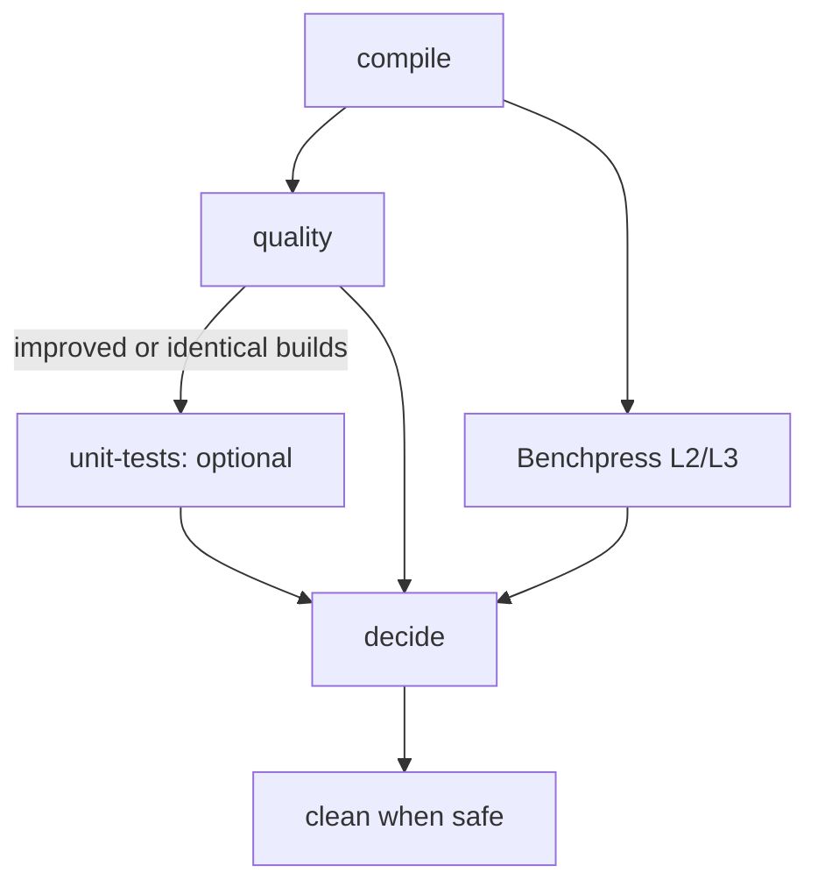

# Running the stages directly

[Documentation index](../README.md) · [LSF session guide](../cluster.md)

Run each stage against one session directory for local work, debugging and replay.
The [LSF launcher](../cluster.md) runs the same stages through a manager job.

## Manual sequence

```bash
uv sync --all-extras
mkdir -p "$HOME/qtb-store" "$HOME/qtb-sessions"
export QTB_STORE="$HOME/qtb-store"
S="$HOME/qtb-sessions/idea1"  # choose a new session path

uv run qiskit-transpile-bench compile \
  --baseline /path/to/baseline --evolved /path/to/evolved \
  --profile confirm-profile --results-root "$S"
uv run qiskit-transpile-bench quality    --results-root "$S"
uv run qiskit-transpile-bench benchpress --results-root "$S"
uv run qiskit-transpile-bench unit-tests --results-root "$S"  # optional
uv run qiskit-transpile-bench decide     --results-root "$S"
```

The default profile is `iterations-profile`; use `confirm-profile` for confirmation.
Later stages read the profile, sources and store from the session. Source folders
are never modified. Confirm quality and Benchpress run only at optimization levels
2 and 3.

Quality includes fresh paired runtime measurements over its full panel, alongside
circuit depth/count and output checks. Benchpress adds the referenced upstream
transpilation panel. Both compare baseline and evolved wall-clock transpilation
runtime. Run them sequentially on an idle machine; no host-load checks or
corrections are applied.

## Commands

| Command | Purpose |
| --- | --- |
| [compile](compile.md) | Snapshot sources, reuse/build baseline, build evolved and verifier, round-trip inputs |
| [quality](quality.md) | Measure circuit depth/count and runtime, check outputs, audit determinism, compute quality gate |
| benchpress | Compare the upstream Benchpress panel at L2/L3, with its own report |
| [unit-tests](unit-tests.md) | Optional upstream Python/Rust suites; once started they bind the verdict |
| [decide](decide.md) | Merge committed evidence into the verdict and reports, then clean when safe |
| [clean](clean.md) | Remove session bulk while preserving results |

A finished stage never runs again. Interrupted or failed stages can resume when
called again, subject to the [session rules](../sessions.md).

## Dependencies and gate



Quality and Benchpress require completed compilation. Benchpress runs independently
of the quality gate, even when quality finds no improvement. Optional unit tests
require completed quality and record `skipped` if its gate closes. Identical builds
open the gate for an A/A check.

Each stage exits 0 when complete or skipped. `decide` may run any time after the
session exists; missing required evidence prevents a conclusive pass and a stage
crash gives `ERROR`. It writes the verdict and cleans session bulk when safe.
Cleanup issues are reported separately without changing the verdict's exit code.

## Exit codes

| Stage exit | Meaning |
| ---: | --- |
| 0 | Complete or skipped, including a previously finished stage |
| 40 | Stage failed |
| 41 | Unmet precondition |
| 64 | Invalid usage |

`decide` returns 0 `PASS`, 10 `NO_IMPROVEMENT`, 20 `CONSTRAINT_VIOLATION`,
30 `INCONCLUSIVE` or 40 `ERROR` ([decision guide](decide.md)).
