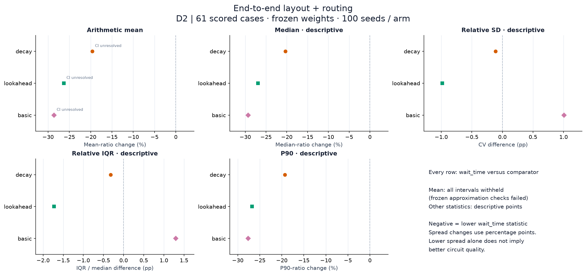
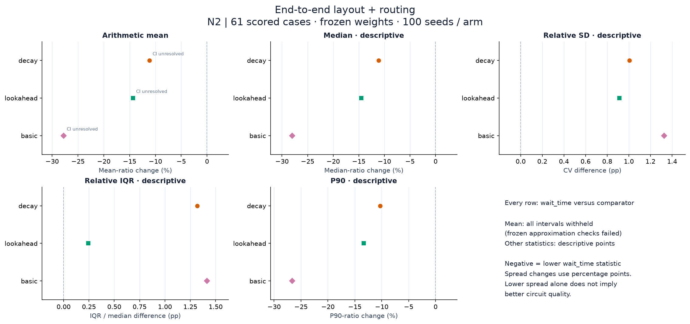
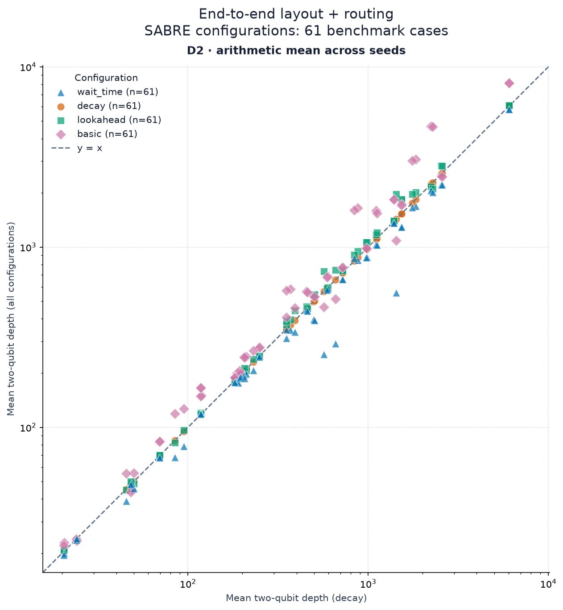
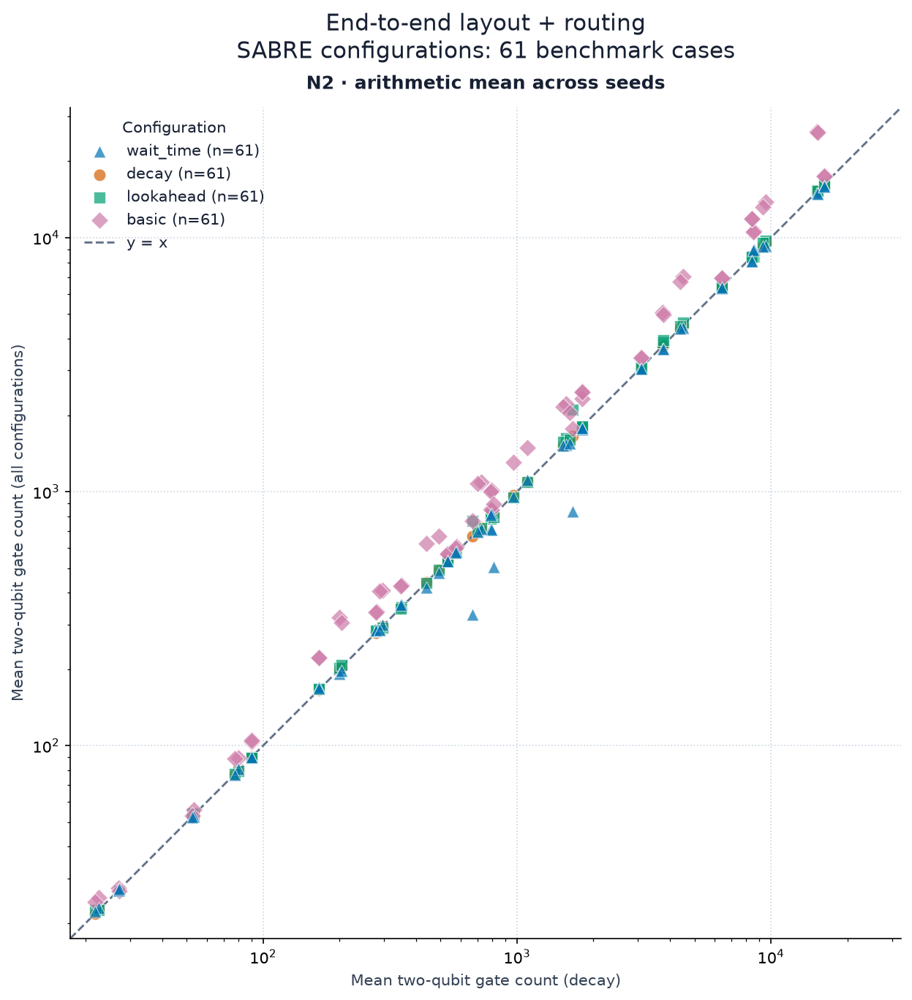

@jakelishman, below are benchmark comparisons, statistical summaries, and uncertainty estimates to help address your request about including `decay` in the preset and choosing the default `wait_time` weighting, including the statistics requested in [#17394](https://github.com/Qiskit/qiskit/issues/17394).

I also added [f055025](https://github.com/Qiskit/qiskit/commit/f055025525f447a1604144992fb6af9049be162b) so that `wait_time` can guide layout search as well as routing. 

**Wait-time layout and routing benchmark**

All changes are `wait_time` relative to the comparator; negative means lower.

| Metric | vs | Mean | Median | P90 | CV (pp) | IQR/median (pp) |
| --- | --- | ---: | ---: | ---: | ---: | ---: |
| D2 | decay | -19.60% | -20.35% | -19.31% | -0.11 | -0.32 |
| D2 | lookahead | -26.30% | -26.92% | -26.76% | -0.98 | -1.73 |
| D2 | basic | -28.60% | -29.31% | -27.65% | +1.01 | +1.30 |
| N2 | decay | -11.15% | -11.13% | -10.30% | +1.01 | +1.32 |
| N2 | lookahead | -14.34% | -14.51% | -13.37% | +0.91 | +0.24 |
| N2 | basic | -27.78% | -28.02% | -26.65% | +1.33 | +1.41 |

**95% intervals**

| vs | D2 mean change CI (%) | N2 mean change CI (%) |
| --- | --- | --- |
| decay | [-19.95, -19.24] | [-11.48, -10.82] |
| lookahead | [-26.64, -25.96] | [-14.66, -14.02] |
| basic | [-28.89, -28.30] | [-28.04, -27.52] |

**Eight families, equal weight**

| Family | Inputs | Cases | Levels | Family weight | Case weight (fraction) | Targets |
| --- | ---: | ---: | --- | ---: | ---: | --- |
| G1: Quantum Fourier transform | 5 | 10 | L2, L3 | 12.5% | 0.0104-0.0208 | `heavy_hex_d9_cz`, `rochester_53`, `melbourne_14_u` |
| G2: Hamiltonian simulation | 1 | 2 | L2, L3 | 12.5% | 0.0625 | `heavy_hex_d9_cz` |
| G3: QAOA | 4 | 8 | L2, L3 | 12.5% | 0.0104-0.0208 | `heavy_hex_d9_cz`, `rochester_53`, `mumbai_27` |
| G4: Quantum volume | 5 | 10 | L2, L3 | 12.5% | 0.0078-0.0156 | `heavy_hex_d9_cz`, `melbourne_14`, `mumbai_27_loose`, `rochester_53_u` |
| G5: Reversible logic, arithmetic | 9 | 18 | L2, L3 | 12.5% | 0.0063-0.0078 | `grid_5x5_u`, `grid_7x7_u`, `rochester_53`, `mumbai_27` |
| G6: Bernstein–Vazirani | 3 | 6 | L2, L3 | 12.5% | 0.0208 | `heavy_hex_d9_cz`, `rochester_53`, `mumbai_27` |
| G7: Variational ansatz | 1 | 1 | L2 only | 12.5% | 0.1250 | `heavy_hex_d9_cz` |
| G8: Routing challenges (QUEKO) | 3 | 6 | L2, L3 | 12.5% | 0.0156-0.0313 | `tokyo_20`, `rochester_53`, `sycamore_54` |

**How the statistics were computed**

- Each case/preset is summarized separately over 100 independent seeds. SD ; Q25, median, Q75 and P90 are the 25th, 50th, 75th and 90th sorted observations. IQR = Q75 − Q25. 
- For each statistic `S` (arithmetic mean, median or P90), form the case ratio `r = S_wait / S_comp`. Report `100 × (exp(Σ w × ln(r)) − 1)%`: the weighted geometric mean of case ratios.
- For `V = SD/mean` (CV) or `IQR/median`, normalize within each preset, then report `100 × Σ w × (V_wait − V_comp)` in percentage points (pp). 

Each scatter point is a case/preset mean over 100 seeds, plotted against that case's `decay` mean.

| Preset | D2 below / above decay | N2 below / above decay |
| --- | ---: | ---: |
| wait_time | 53 / 8 | 39 / 22 |
| lookahead | 13 / 48 | 27 / 34 |
| basic | 10 / 51 | 1 / 60 |

Family breakdown

Mean changes in %, shown as **D2 / N2**. Case weights are renormalized within each family (and for level/exclusion comparisons). All families include L2 and L3 except G7, which is L2 only.

| Family | Cases | vs decay | vs lookahead | vs basic |
| --- | ---: | ---: | ---: | ---: |
| G1: Quantum Fourier transform | 10 | -4.86 / -0.60 | -10.12 / -2.46 | -37.86 / -26.60 |
| G2: Hamiltonian simulation | 2 | -12.52 / -3.24 | -21.79 / -2.57 | -25.09 / -24.23 |
| G3: QAOA | 8 | -13.33 / -1.43 | -19.13 / -2.11 | -38.83 / -27.69 |
| G4: Quantum volume | 10 | -7.74 / -0.31 | -11.86 / -0.27 | -9.89 / -7.00 |
| G5: Reversible logic, arithmetic | 18 | -2.25 / +0.18 | -2.43 / +0.48 | -19.31 / -22.70 |
| G6: Bernstein–Vazirani | 6 | -24.50 / -18.98 | -29.78 / -21.61 | -17.35 / -33.44 |
| G7: Variational ansatz | 1 | -60.89 / -49.48 | -71.67 / -60.24 | -48.75 / -52.60 |
| G8: Routing challenges (QUEKO) | 6 | -9.05 / +0.20 | -10.50 / -0.28 | -22.95 / -18.88 |

